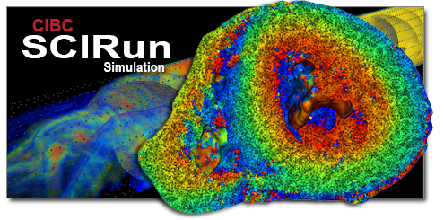

<div align="center">



**SCIRun is a dataflow-based platform for scientific visualization and computation:<br>
wire modules into a network, run it, and explore the results interactively.**

<!-- Windows push runs skip the build job, so its badge tracks the nightly schedule instead. -->
[](https://github.com/SCIInstitute/SCIRun/actions/workflows/mac.yml?query=branch%3Amaster)
[](https://github.com/SCIInstitute/SCIRun/actions/workflows/ccpp.yml?query=branch%3Amaster)
[](https://github.com/SCIInstitute/SCIRun/actions/workflows/windows.yml?query=event%3Aschedule)
[](https://github.com/SCIInstitute/SCIRun/actions/workflows/regression-tests.yml?query=event%3Aschedule)
[](https://codecov.io/gh/SCIInstitute/SCIRun)
<br>
[](https://scirun.readthedocs.io/en/latest/)
[](https://github.com/SCIInstitute/SCIRun/releases)
[](LICENSE.md)

</div>

##### [Contents](#user-content-scirun-5-prototype "generated with DocToc(http://doctoc.herokuapp.com/)")

- [SCIRun 5](#user-content-scirun-5)
	- [Summary](#user-content-summary)
	- [Goals](#user-content-goals)
	- [Install](#user-content-install)
 	  - [Nightly installers](#user-content-nightly-installers)
 	  - [Build from source](#user-content-build-from-source)
	- [Documentation](#user-content-documentation)
 	  - [Python API](#user-content-python-api)
	- [Questions and Answers](#user-content-questions-and-answers)
	- [License and Credits](#user-content-license-and-credits)

### Summary

| Warning! |  SCIRun 5 is beta software, you may use for real science but beware of instability.  |
|:--------:|:-------------------------------------------------------------------------------------:|

### Goals
SCIRun 5 is a complete rewrite of the GUI front end and graphical components of SCIRun 4, including a more stable and
efficient middle layer, with support for Python scripting.

### Install

#### Nightly installers
Built from `master` every night; the links below always point at the latest build.
Release notes and every variant are on the [nightly release page](https://github.com/SCIInstitute/SCIRun/releases/tag/nightly).

| Platform | Installer | Runs on |
|---|---|---|
| macOS, Apple silicon | [SCIRun-nightly-macos14-arm64-qt6-python.pkg](https://github.com/SCIInstitute/SCIRun/releases/download/nightly/SCIRun-nightly-macos14-arm64-qt6-python.pkg) | macOS 14 or newer |
| Windows | [SCIRun-nightly-windows-x64-qt5-python.exe](https://github.com/SCIInstitute/SCIRun/releases/download/nightly/SCIRun-nightly-windows-x64-qt5-python.exe) | Windows 10/11, x64 |
| Windows, Qt 6 | [SCIRun-nightly-windows-x64-qt6-python.exe](https://github.com/SCIInstitute/SCIRun/releases/download/nightly/SCIRun-nightly-windows-x64-qt6-python.exe) | Windows 10/11, x64 |
| Linux | No installer yet ([#2851](https://github.com/SCIInstitute/SCIRun/issues/2851)): [build from source](#user-content-build-from-source) | |
| macOS, Intel | No daily installer: [build from source](#user-content-build-from-source) | |

The installers are not signed yet ([#1663](https://github.com/SCIInstitute/SCIRun/issues/1663)), so the OS blocks them on first launch:
- **macOS:** `xattr -dr com.apple.quarantine SCIRun-nightly-*.pkg`, then open the package.
- **Windows:** at the SmartScreen prompt choose **More info**, then **Run anyway**.

Tagged builds are on the [releases page](https://github.com/SCIInstitute/SCIRun/releases).

#### Build from source
You need CMake 3.21+, a C++17 compiler and, for the GUI, Qt 5.15 or Qt 6.3.1+.
The Superbuild downloads and compiles every other dependency, so the first build takes 30–90 minutes and about 15 GB of disk.

```bash
git clone https://github.com/SCIInstitute/SCIRun.git
cd SCIRun
./build.sh                 # Linux and macOS; --help lists options such as --headless and -j8
```

```powershell
.\build.ps1 -BuildDir C:\SR  # Windows; offers to install any missing tools, Qt included
```

On Windows keep the build directory short: the Superbuild nests deeply enough to hit the 260-character path limit.
Platform requirements, CMake presets and all build options are in the [build guide](https://scirun.readthedocs.io/en/latest/start/build.html).

### Documentation
For documentation, please see: https://scirun.readthedocs.io/en/latest/

#### Python API
Please see https://scirun.readthedocs.io/en/latest/user_doc/python.html

#### Example Data
Please see: https://github.com/CIBC-Internal/SCIRunTestData

Or, for the older dataset:
https://www.sci.utah.edu/releases/scirun_v4.7/SCIRunData_4.7_20160120_data.zip
https://www.sci.utah.edu/releases/scirun_v4.7/SCIRunData_4.7_20160120_data.tgz

### Questions and Answers
For help, check out the discussion page: https://github.com/SCIInstitute/SCIRun/discussions.

### License and Credits
  For more information, please see: http://software.sci.utah.edu

  Icons made by [DinosoftLabs](https://www.flaticon.com/authors/dinosoftlabs) from [www.flaticon.com](https://www.flaticon.com/).

  The MIT License

  Copyright (c) 2023 Scientific Computing and Imaging Institute,
  University of Utah.


  Permission is hereby granted, free of charge, to any person obtaining a
  copy of this software and associated documentation files (the "Software"),
  to deal in the Software without restriction, including without limitation
  the rights to use, copy, modify, merge, publish, distribute, sublicense,
  and/or sell copies of the Software, and to permit persons to whom the
  Software is furnished to do so, subject to the following conditions:

  The above copyright notice and this permission notice shall be included
  in all copies or substantial portions of the Software.

  THE SOFTWARE IS PROVIDED "AS IS", WITHOUT WARRANTY OF ANY KIND, EXPRESS
  OR IMPLIED, INCLUDING BUT NOT LIMITED TO THE WARRANTIES OF MERCHANTABILITY,
  FITNESS FOR A PARTICULAR PURPOSE AND NONINFRINGEMENT. IN NO EVENT SHALL
  THE AUTHORS OR COPYRIGHT HOLDERS BE LIABLE FOR ANY CLAIM, DAMAGES OR OTHER
  LIABILITY, WHETHER IN AN ACTION OF CONTRACT, TORT OR OTHERWISE, ARISING
  FROM, OUT OF OR IN CONNECTION WITH THE SOFTWARE OR THE USE OR OTHER
  DEALINGS IN THE SOFTWARE.
